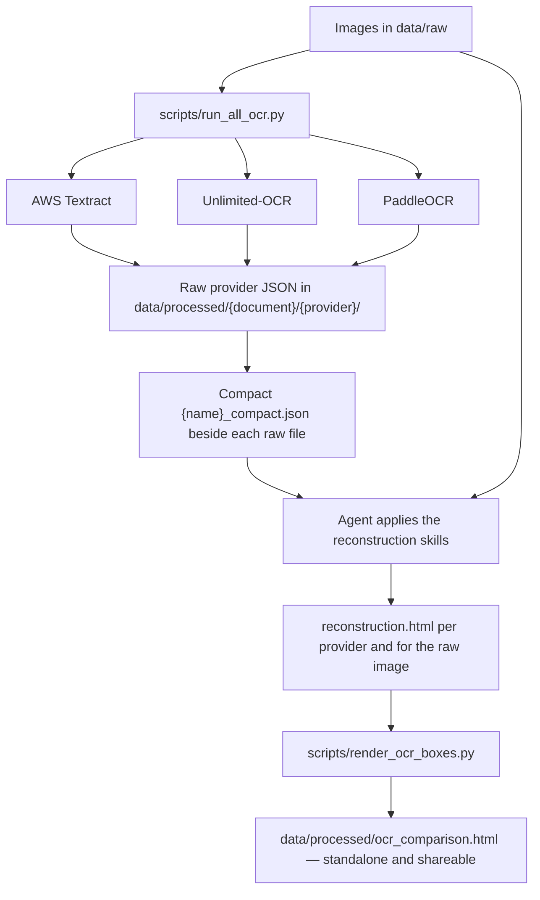

Run several OCR solutions on the same documents and visually compare the
results. AWS Textract, PaddleOCR, and a local Unlimited-OCR model each extract
text, tables, forms, and layout geometry from document images in `data/raw`.
Every provider's raw JSON is compacted into LLM-friendly form, an agent
reconstructs each document as static HTML from that JSON (and once from the
raw image itself), and a standalone viewer renders each provider's bounding
boxes over the source image beside its reconstruction.

## Workflow



1. Run every OCR provider; this also writes the compact LLM-optimized JSON:

   ```shell
   uv run python scripts/run_all_ocr.py data/raw/document.png
   ```

2. Ask an agent to apply
   `.agents/skills/ocr-html-reconstruction/SKILL.md` once for each compact
   provider JSON, and
   `.agents/skills/raw-image-html-reconstruction/SKILL.md` once for the raw
   image. These skills write reconstructions to
   `data/processed/<document>/<source>/reconstruction.html`.

3. Render the unified cross-document, cross-provider comparison viewer:

   ```shell
   uv run python scripts/render_ocr_boxes.py
   ```

## AWS Textract

`scripts/run_textract.py` analyzes PNG/JPEG images synchronously, or PDF/TIFF
documents asynchronously via a temporary S3 upload that is deleted after the
job, using [Amazon Textract](https://aws.amazon.com/textract/)'s `FORMS` and
`TABLES` features. The complete block
response is saved to `data/processed/<input-name>/textract/result.json`.

Install dependencies with `uv sync`. Configure AWS credentials using the normal
credential chain, or copy `.env.example` to a project-root `.env` and fill in
`AWS_ACCESS_KEY_ID`, `AWS_SECRET_ACCESS_KEY`, and `AWS_DEFAULT_REGION` (add
`AWS_SESSION_TOKEN` for temporary credentials). Never commit `.env`.

```shell
uv run python scripts/run_textract.py data/raw/scan.png
uv run python scripts/run_textract.py data/raw/scan.pdf --bucket my-textract-inputs
```

Use `--region`, `--output`, `--poll-interval`, and `--timeout` to override the
defaults.

## PaddleOCR

`scripts/run_paddle_ocr.py` runs
[PaddleOCR](https://github.com/PaddlePaddle/PaddleOCR)'s PP-StructureV3
pipeline with table
recognition and table-cell results, writing the raw response to
`data/processed/<input-name>/paddle_ocr/result.json`. Orientation correction
and unwarping are disabled so coordinates stay in the source-image system used
by the viewer.

PaddlePaddle has no CPython 3.14 wheel, so PaddleOCR runs in its own CPython
3.13 environment:

```shell
uv venv --python 3.13 .venv-paddleocr
# Windows
uv pip install --python .venv-paddleocr/Scripts/python.exe paddlepaddle==3.2.2 paddleocr==3.7.0 "paddlex[ocr]==3.7.2"
# macOS/Linux
uv pip install --python .venv-paddleocr/bin/python paddlepaddle==3.2.2 paddleocr==3.7.0 "paddlex[ocr]==3.7.2"
```

```shell
uv run python scripts/run_paddle_ocr.py data/raw/scan.png
```

Use `--python`, `--lang`, or `--output` to override the defaults.

## Unlimited-OCR

`scripts/run_unlimited_ocr.py` runs the sibling
[Unlimited-OCR-Universal](https://huggingface.co/sabafallah/Unlimited-OCR-Universal)
checkout's demo (a device-agnostic fork of
[baidu/Unlimited-OCR](https://github.com/baidu/Unlimited-OCR)) using that
checkout's `.venv` (create/sync it first, or pass
`--repo`/`--python`). It writes the demo artifacts (`result.md`, annotated
images, crops) plus `raw_generation.json` — prompt, token IDs, raw and
processed text, and detected objects with pixel boxes — to
`data/processed/<input-name>/unlimited_ocr`.

```shell
uv run python scripts/run_unlimited_ocr.py image data/raw/scan.png
uv run python scripts/run_unlimited_ocr.py multi data/raw/page1.png data/raw/page2.png
uv run python scripts/run_unlimited_ocr.py pdf data/raw/document.pdf --dpi 300
```

The image mode accepts `--mode gundam` (default) or `--mode base`; multi-image
and PDF inference always use the base mode. The prompt must begin with
`<image>`.

## Running all providers

`scripts/run_all_ocr.py` runs Textract, Unlimited-OCR, and PaddleOCR for each
supplied image, writes batch metadata (provider commands, parameters, return
codes, diagnostics, and runtimes) to `data/processed/ocr_run_metadata.json`,
then compacts every raw OCR JSON as described below.

```shell
uv run python scripts/run_all_ocr.py data/raw/*.png data/raw/*.jpg
```

Options: `--metadata`, `--region`, `--bucket` (enables Textract for TIFF
inputs), `--unlimited-mode`, `--paddle-lang`, and `--paddle-python`. Textract
is skipped with a notice for formats it cannot process; files that cannot be
compacted are skipped with a warning instead of failing the batch.

## LLM-optimized OCR JSON

As its final step, `scripts/run_all_ocr.py` writes a compact
`<name>_compact.json` beside every raw OCR JSON under `data/processed`, never
modifying the raw responses. The compact files keep the content and layout
evidence needed to reproduce each document — reading-order text, geometry,
table HTML and cells, form key/value pairs, checkbox states, and Unlimited-OCR
Markdown with object boxes — while dropping runtime settings, relationship
graphs, and machine-specific paths.

## OCR comparison viewer

`scripts/render_ocr_boxes.py` builds one self-contained interactive HTML file
for every BMP, JPEG, PNG, or WebP image under `data/raw`: the source image
with interactive provider bounding boxes on the left, and the corresponding
pre-generated HTML reconstruction on the right. Select **Raw image** to view
the source without boxes beside the raw-image reconstruction.

```shell
uv run python scripts/render_ocr_boxes.py
```

The viewer requires reconstructions at
`data/processed/<input-name>/<provider>/reconstruction.html` and
`data/processed/<input-name>/raw_image/reconstruction.html`. The output
defaults to `data/processed/ocr_comparison.html` with every image and
reconstruction embedded for sharing. Pass image paths to restrict the viewer,
or use `--textract`, `--unlimited`, `--paddle`, and `--output` to override
locations.
